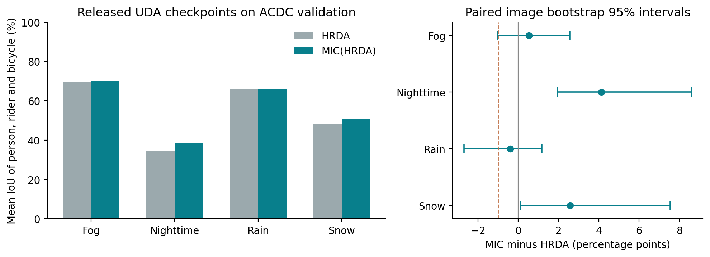
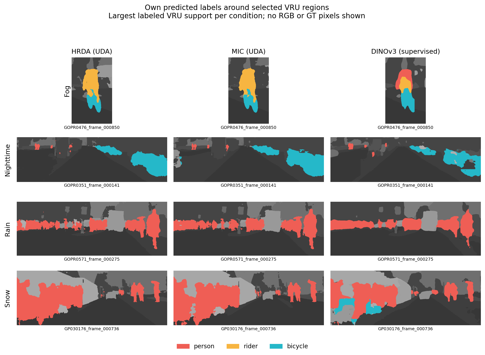

# Transformer Segmentation of Vulnerable Road Users in Adverse Conditions

MAAI901 applied vision transformer project by Ayman Lakhnati.

[Automated reproducibility workflow](https://github.com/AymanLakhnati/Adverse-Condition-VRU-Segmentation/actions/workflows/tests.yml). Local validation evidence is provided under `results/reproducibility/`; the hosted workflow did not execute in this environment. No hosted-pass claim is made.

[Open the executable notebook in Colab](https://colab.research.google.com/github/AymanLakhnati/Adverse-Condition-VRU-Segmentation/blob/main/notebooks/Adverse_Condition_VRU_Segmentation.ipynb). Select a GPU runtime before running it. The notebook can also run locally or in Kaggle.

This project studies **person, rider, and bicycle segmentation across fog, nighttime, rain, and snow** in the official ACDC benchmark. It retains the subject of the preceding research proposal.

The implemented study has two clearly separated parts:

1. **Original proposal analysis:** independently evaluate the authors' released HRDA and MIC(HRDA) MiT-B5 checkpoints on all 406 ACDC validation images. Test whether MIC increases the weakest condition's three-class mean IoU by at least 2 percentage points, while no condition loses more than 1 point.
2. **New supervised experiment:** tune the learning rate on recording-family-disjoint internal groups drawn only from ACDC's 1,600 training images, then freshly train a 7,315-parameter segmentation head on all training images using frozen DINOv3 ViT-S/16 dense patch features. This is target-supervised transfer learning, distinct from unsupervised domain adaptation.

The DINOv3 model adds a recent transformer family and fresh training to the applied assignment. Its training labels, pretraining, and decoder differ from HRDA/MIC; the models do not form a controlled architecture ablation. The released HRDA and MIC checkpoints also use different training seeds, so their comparison is descriptive rather than a matched causal estimate of MIC's contribution.

## Completed validation results

All models were evaluated on the complete original **406-image ACDC validation split**. These are local measurements, not private test-server scores. Scores are percentages; W is the lowest condition-specific person/rider/bicycle mean IoU.

| Model and learning setting | Fog VRU IoU | Night VRU IoU | Rain VRU IoU | Snow VRU IoU | W | Pooled 19-class mIoU |
|---|---:|---:|---:|---:|---:|---:|
| HRDA, released UDA checkpoint | 69.73 | 34.45 | 66.29 | 48.02 | 34.45 | 65.24 |
| MIC(HRDA), released UDA checkpoint | 70.25 | 38.58 | 65.88 | 50.60 | 38.58 | 69.60 |
| DINOv3, new supervised ACDC head | 48.25 | 37.33 | 67.61 | 44.32 | 37.33 | 62.75 |

The HRDA/MIC point estimates meet the proposed thresholds: **W improves by 4.13 percentage points**, and rain's 0.41-point decrease stays within the 1-point margin. The paired-image bootstrap 95% interval for the W difference is **0.17 to 8.56 points**; rain's interval is **-2.71 to 1.17 points**. These intervals do not establish the full joint threshold statistically. Thirteen of 2,000 draws were undefined for snow/W because of sparse rider support.

Snow rider illustrates the limits of averages: only **1,867 labeled pixels across two images**, with IoU 3.04% for HRDA, 2.96% for MIC and 0% for DINOv3. The released checkpoints also use different seeds. The DINOv3 extension has different supervision/pretraining and is not a controlled comparison of architectures or evidence of MIC's causal effect.

Train-only learning-rate trials selected **0.003** using 1,198 fitting and 402 development images in disjoint recording families. A fresh head then completed **five epochs, all 1,600 training images and 2,000 optimizer steps**, with the encoder hash unchanged. Official validation did not select the rate. See [measured results and independent audit](docs/RESULTS.md), [trial evidence](outputs/dinov3_tuning/tuning_trials.csv), and the saved training configuration and logs.





## Reproduce

Python 3.12 is tested. A CUDA GPU is recommended. The sequential inference port was designed to fit a 4 GB GTX 1650 Ti.

`main` includes measured reference evidence and nonempty result/training folders; large prediction masks remain excluded. For a **clean rerun**, create a separate checkout pinned to the frozen source-only experiment commit. This preserves reference evidence and avoids mixing prior manifests, training outputs or platform-specific inference identities into a new run:

```powershell
git clone --no-checkout https://github.com/AymanLakhnati/Adverse-Condition-VRU-Segmentation.git VRU-Segmentation-clean
cd VRU-Segmentation-clean
git checkout --detach 2b4a5325f7b5843a6d5e5f1d52922a05f926c9c7
git rev-parse HEAD
git status --short --branch
```

Use a new directory name if `VRU-Segmentation-clean` already exists. Do not reset, delete or move an existing working checkout or evidence directory. The detached ref identifies the exact experiment source; later `main` documentation can be read separately. Install and run the following commands inside this clean checkout. The Colab/Kaggle notebook performs the same pinned separate-clone setup automatically and prints its actual commit/ref. Existing local notebook sessions can instead reuse completed artifacts when their provenance matches; this is distinct from a fresh rerun. Cross-platform bitwise identity is not assumed.

```powershell
python -m venv .venv
.\.venv\Scripts\python.exe -m pip install torch==2.5.1 torchvision==0.20.1 --index-url https://download.pytorch.org/whl/cu118
.\.venv\Scripts\python.exe -m pip install -r requirements.txt
.\.venv\Scripts\python.exe -m pytest -q
.\.venv\Scripts\Activate.ps1
```

For another CUDA driver/platform, install the appropriate official PyTorch wheel. The activation command makes the following `python` commands use the project environment. CPU execution is supported but substantially slower; replace `--device cuda` with `--device cpu`. Run every command from the repository root. The executable [notebook](notebooks/Adverse_Condition_VRU_Segmentation.ipynb) preserves cloud cloning and dependency installation for Colab/Kaggle.

First download the shared data and published checkpoints:

```powershell
python -m roadseg.download_checkpoints
python -m roadseg.download_acdc --include-train
```

Run the original HRDA/MIC checkpoint analysis:

```powershell
python -m roadseg.run_inference --device cuda --expected 406
python -m roadseg.metrics results/manifest.csv --path-root . --output results --bootstrap 2000 --require-official-validation
```

Run the separate supervised DINOv3 search and fresh full refit, then evaluate its fixed final head:

```powershell
python -m roadseg.tune_dinov3 --device cuda --refit
python -m roadseg.evaluate_dinov3 --device cuda --batch-size 4
```

After both evaluations complete, generate the measured visualizations:

```powershell
python -m roadseg.visualize
```

After training, predict a single downloaded ACDC image with `python -m roadseg.predict IMAGE_PATH --model dinov3`. Select `--model hrda` or `--model mic` for a released checkpoint. The command writes a numeric label mask, an abstract color preview and a JSON sidecar with class pixel counts. Pixel counts are not object detections or counts of people.

The official RGB package is approximately 15.6 GiB (16.7 GB) and its endpoint does not support range requests. The streaming downloader reads the package while retaining only the adverse training and validation images, checks each retained ZIP member's CRC32, and verifies the label archive's official MD5. It does **not** claim to verify the full RGB archive MD5. Raw data remain local. The downloader uses OS certificate roots without disabling TLS validation.

Tuning and training refuse to overwrite nonempty output directories. The notebook reuses a completed search/refit only after checking their provenance. If the search completed without a refit, launch `roadseg.train_dinov3` with the actual saved `--learning-rate` and `--tuning-results outputs/dinov3_tuning/tuning_results.json`; trial weights are never resumed as the final model. Preserve incomplete runs and choose new output directories when restarting them. Inference can resume using unchanged model/settings provenance. Never use official validation outcomes to select the DINOv3 learning rate or alter the protocol while retaining an untouched evaluation claim.

## Methods and outputs

The primary metric is condition-specific VRU mean IoU: the arithmetic mean of the person, rider, and bicycle IoUs calculated from **pooled pixel confusion counts** in each condition. `W` is the minimum across the four conditions, recomputed independently for each model. Train IDs are 11, 12, and 18; only GT ID 255 is ignored. An absent class with zero union has undefined IoU and cannot silently become perfect or disappear from the three-class hypothesis.

The HRDA/MIC inference port preserves the official dual-scale attention, 1024-pixel outer windows with stride 512, and 512-pixel detail windows with stride 256. It processes detail crops sequentially to reduce memory. The MiT backbone was checked numerically against the official source; checkpoint loading rejects missing and unexpected student tensors. Modern PyTorch kernels can still differ numerically from the original environment. Published training logs provide an additional aggregate validation reference, not new experimental results.

DINOv3 uses frozen normalized patch features with stride 16 and a learned 1x1 convolution into 19 classes. Before the full fit, three one-epoch AdamW trials compare learning rates **0.0003, 0.001 and 0.003**. Within each weather condition, matching GoPro chapters such as `GOPR0376` and `GP010376` stay together as one conservative recording family. A seed-42 ordered recording-family subset targets the nearest feasible 20% development holdout. Equal-distance count ties favor more development frames; equal-count subsets follow seeded family order. Large families can shift the actual fraction; the saved manifests report exact counts. Fitting and development recording families remain disjoint. Trials share the same fresh head initialization and fitting crop/flip randomness.

Selection maximizes pooled person/rider/bicycle mean IoU on one deterministic 512-pixel center crop per development image; exact ties choose the lower LR. Only if all three VRU means are undefined does the declared present-class mIoU fallback apply, and the saved results explicitly disclose it. This one-epoch, center-crop search is a limited proxy rather than exhaustive tuning. **Official validation and test images never enter selection.**

All trial weights are discarded. A fresh seeded head then fits all 1,600 training images for **five fixed epochs**, using the selected LR held fixed, AdamW weight decay 0.01, batch size 4, random 512-pixel crops/flips and cross-entropy ignoring label 255. There is no official-validation tuning, early stopping or official-validation checkpoint selection. Final evaluation averages overlapping 512-pixel tile logits at stride 384 at original image resolution. Report the measured selected LR and selection metric from the tuning JSON, rather than assuming the default 0.001 won.

Important generated outputs:

| Path | Contents |
|---|---|
| `results/summary.json` | HRDA/MIC condition and pooled metrics, hypothesis and paired bootstrap intervals |
| `results/manifest.csv` | Exact evaluated image IDs, hashes, model outputs and timing |
| `results/per_image_confusions.npz` | Paired pixel confusion counts for independent reanalysis |
| `results/dinov3/summary.json` | Separate supervised DINOv3 segmentation results |
| `outputs/dinov3_tuning/tuning_results.json` | Actual internal split, three trials, selection metric, selected LR and any fallback |
| `outputs/dinov3_tuning/tuning_trials.csv` | Measured one-epoch trial scores and timing |
| `outputs/dinov3_tuning/fit_manifest.csv`, `development_manifest.csv` | Train-only recording families, original chapter directories, image IDs and hashes |
| `outputs/dinov3_tuning/training_steps.csv` | Per-trial losses, gradients and crop/flip records |
| `outputs/dinov3_dense/training_config.json` | Actual training configuration, status and unchanged encoder hash |
| `outputs/dinov3_dense/training_steps.csv` | Measured losses and optimization record |
| `outputs/dinov3_dense/head.pt` | Small trained semantic head and foundation-model identity |
| `results/figures/` | Charts and abstract model prediction visualizations |

The official validation split has 100 fog, 106 night, 100 rain, and 100 snow images. It is **validation**, not the private benchmark test set. The released checkpoints were selected using validation information by their authors. Image bootstrap intervals are conditional summaries and do not capture scene dependence, model training variability, or deployment shift.

## Sources and responsible use

See [references](docs/REFERENCES.md), [training provenance](docs/TRAINING_PROVENANCE.md), [model card](docs/ETHICS_AND_MODEL_CARD.md), and [proposal alignment](docs/topic_requirements.md).

ACDC data are governed by the official noncommercial research license. This repository excludes source images, ground-truth masks, raw-image overlays and foundation checkpoints. Code obtains them directly from the official sources. Public illustrations use aggregate statistics and abstract model predictions. Neither segmentation scores nor confidence establish driving safety, collision risk, human demographic fairness, or universal weather robustness.

The backbone/decoder adaptations retain their upstream attribution and licenses in `licenses/`. DINOv3 uses Meta's custom DINOv3 terms. No blanket project license overrides third-party rights.

AI tools assisted implementation, literature checking, analysis and document preparation. The student should verify the artifacts, understand the experimental distinctions, and follow the course's disclosure rules.

## Revised implementation and additional analysis

See [revision notes](docs/REVISION_NOTES.md) for cached-input and prediction integrity checks and the distinction between the original frozen experiment source and the revised software. [Recording-family sensitivity](docs/RECORDING_SENSITIVITY.md) provides an explicitly exploratory analysis from the saved counts.

## Demonstrate and audit the software

The current implementation supports [folder prediction and evidence verification](docs/SOFTWARE_GUIDE.md). Run `python scripts/verify_results.py` to independently check saved metrics and the tuning/refit chain without a dataset download, checkpoint loading or GPU. Run `python -m roadseg.predict IMAGE_DIRECTORY --recursive --model dinov3 --output working/new_batch --device cuda` for a deterministic folder batch with one model load and protected outputs. Always select a fresh output directory.

The expanded local suite passes 54 tests (`results/reproducibility/final_tests.xml`). The two-image real DINOv3 batch reproduces the original saved prediction pixels (`results/reproducibility/batch_feature_smoke.json`). See the [grading evidence map](docs/GRADING_EVIDENCE.md) for rubric coverage. Conceptual presentation artwork is labeled and documented under `assets/presentation/ARTWORK.md`; it is separate from experimental outputs.
